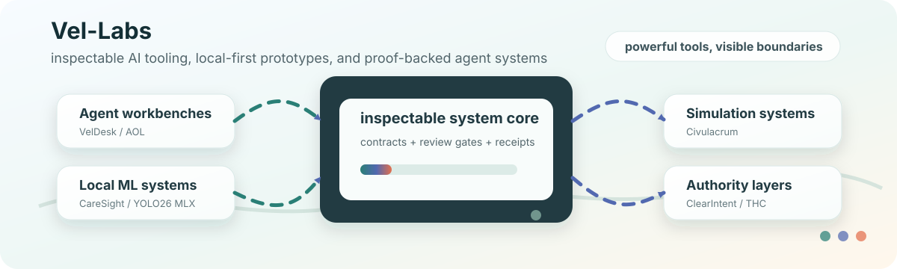

  

# Vel-Labs

Vel-Labs is the home for [Steven Pajewski's](https://github.com/velcrafting) public AI research, software experiments, and tools.

The work starts with practical friction: a capable coding agent that's hard to follow, a useful model that needs a better way to interact with software, or a prototype whose results need closer inspection. Building around those problems leads to interfaces, local AI applications, developer tools, and methods that can be reused across projects.

The larger goal is to make AI more useful in everyday work, with enough visibility for people to understand the result and decide what comes next.

## What We Build

| Lane | Repositories | Why it matters |
| --- | --- | --- |
| Agent workbenches | [VelDesk](https://github.com/Vel-Labs/VelDesk) | Give people a clearer view of coding-agent sessions, permissions, and runtime state. |
| Capability layers | [vel-mcp](https://github.com/Vel-Labs/vel-mcp) | Connect models to tools such as vision and speech without treating every capability as the same permission. |
| Local-first ML | [CareSight](https://github.com/Vel-Labs/CareSight), [yolo26-mlx-swift](https://github.com/Vel-Labs/yolo26-mlx-swift) | Explore what AI can do close to the user, from home-care observations to vision on Apple hardware. |
| Agent authority | [ClearIntent](https://github.com/Vel-Labs/ClearIntent) | Make proposed agent actions easier to review and authorize before they affect other systems. |
| Reliability and governance | [thc-methodology](https://github.com/Vel-Labs/thc-methodology), [project-scaffold](https://github.com/Vel-Labs/project-scaffold), [thc-leaderboard](https://github.com/Vel-Labs/thc-leaderboard) | Provide methods, project structure, and comparison tools for examining the claims behind a build. |

## Start Here

| If you want to explore... | Start with |
| --- | --- |
| The experience of using a coding agent | [VelDesk](https://github.com/Vel-Labs/VelDesk) |
| Tools that give models more useful capabilities | [vel-mcp](https://github.com/Vel-Labs/vel-mcp) |
| A local AI prototype for caregiver observations and review | [CareSight](https://github.com/Vel-Labs/CareSight) |
| Permission and review for agent actions | [ClearIntent](https://github.com/Vel-Labs/ClearIntent) |
| A way to examine what a project claims and demonstrates | [thc-methodology](https://github.com/Vel-Labs/thc-methodology) |

## How the projects fit together

These projects look at different parts of the same experience. A workbench helps someone follow an agent's work. Capability tools let it interact with software. Local model experiments explore where processing can happen. Review methods and project scaffolds make the results easier to understand and build on.

Lessons can move between projects without making them one product. A useful interface pattern, a failed experiment, or a clearer way to document a result can inform the next build.

The wider research explores coordination, memory, and simulation, alongside the tools and prototypes linked here.

## Reading the lab

The repositories include tools, prototypes, and research. Their READMEs describe the setup, tests, and remaining gaps for each project. Inclusion here doesn't imply production readiness or an ongoing support commitment.

The aim is to make the work understandable: what problem prompted it, what was built, what the evidence shows, and what is still being learned.

## Recommended Pins

These five projects are a useful introduction to the lab:

1. [VelDesk](https://github.com/Vel-Labs/VelDesk)
2. [vel-mcp](https://github.com/Vel-Labs/vel-mcp)
3. [CareSight](https://github.com/Vel-Labs/CareSight)
4. [ClearIntent](https://github.com/Vel-Labs/ClearIntent)
5. [thc-methodology](https://github.com/Vel-Labs/thc-methodology)

Read more at [velcrafting.com](https://www.velcrafting.com) or explore [Steven's profile](https://github.com/velcrafting).

## Public Builds

<!-- workspace-public-builds:start -->
| Project | Description |
| --- | --- |
| [GodotBuddy](https://github.com/Vel-Labs/GodotBuddy) | Local Godot development companion with a CLI, web board and asset checks. Static QA does not establish visual quality or successful Godot import. |
<!-- workspace-public-builds:end -->
